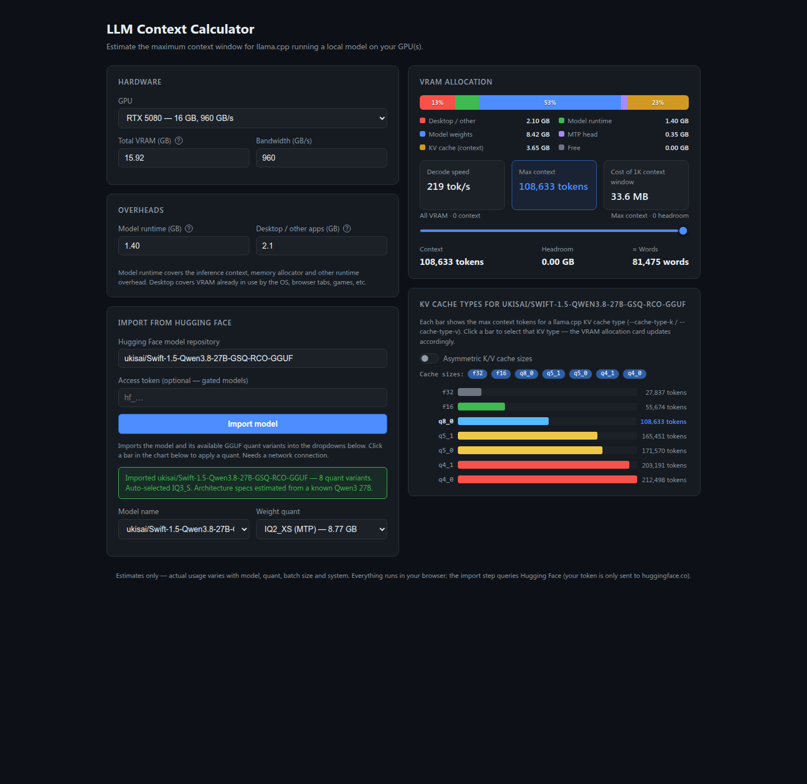

# LLM Context Calculator

Estimate the maximum context window for [llama.cpp](https://github.com/ggml-org/llama.cpp) running a local model on your GPU(s).

## Quick start

Open `index.html` in a browser — that's it. No build, no dependencies; it works straight from `file://`.

1. Pick your GPU — VRAM and bandwidth auto-fill (both remain editable).
2. Import a model from [Hugging Face](https://huggingface.co) (e.g. `Qwen3-4B-GGUF`). Its GGUF quant variants populate the dropdowns, and the largest quant that fits in your VRAM is auto-selected.
3. Read the results — max context, KV cache cost per 1K tokens, decode speed — and drag the slider to pick a context size with a headroom margin.

## How it works

- **Weights**: the size of the selected GGUF file. MTP variants are separate models (base + MTP head).
- **KV cache**: `2 × layers × KV heads × head dim × bytes-per-element` per token. The chart compares llama.cpp KV cache types (`--cache-type-k` / `--cache-type-v`), including asymmetric K/V pairs.
- **Max context** = remaining VRAM ÷ KV bytes per token.
- **Decode speed** ≈ bandwidth ÷ bytes read per token (MTP-aware).

## Features

- GPU presets (NVIDIA / AMD / Intel) with VRAM + bandwidth auto-fill
- HF import with gated-model token support
- MTP variants handled as separate models
- Asymmetric K/V cache mode
- VRAM allocation bar with per-segment tooltips
- Context slider with live headroom readout
- `nvidia-smi` helpers with copy-to-clipboard

## Notes

- Estimates only — actual usage varies with model, quant, batch size and system.
- Everything runs in your browser; the import step queries Hugging Face (your token is only sent to huggingface.co).

## License

[MIT](LICENSE)

## Credits

Built around [llama.cpp](https://github.com/ggml-org/llama.cpp) and [Hugging Face](https://huggingface.co).
